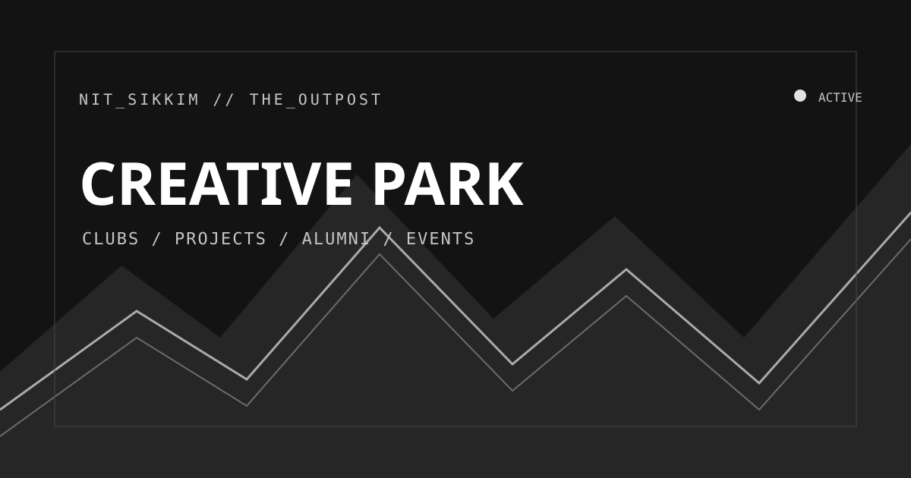

# NIT Sikkim Creative Park

A responsive campus showcase for NIT Sikkim clubs, student projects, alumni, events, recruitment partners, and campus metrics.



**Preview:** [Open the live website](https://codersonet.github.io/nitsikkim-creatives/) · [View the social preview](social-preview.svg)

## Explore the site

- **[Overview](index.html)** — the campus creative hub and featured projects.
- **[Clubs & projects](pages/clubs.html)** — browse student-led groups and project cards.
- **[Alumni](pages/alumni.html)** — explore the alumni directory.
- **[Events](pages/events.html)** — discover fests, activities, and event information.
- **[Metrics](pages/metrics.html)** — view campus engineering metrics.
- **[Recruitment partners](pages/companies.html)** — explore participating organizations.
- **[Contact](pages/contact.html)** — open the contact interface.

## Run locally

This is a static website; there is no build step or package installation.

```bash
python3 -m http.server 5501
```

Open <http://localhost:5501> in your browser. A local HTTP server is recommended so page assets and links behave as they do when hosted.

## Project files

```text
.
├── index.html                 # Landing page
├── pages/                     # All secondary HTML pages
│   ├── alumni.html            # Alumni directory
│   ├── clubs.html             # Clubs and project directory
│   ├── companies.html         # Recruitment partners
│   ├── contact.html           # Contact interface
│   ├── events.html            # Events and fests
│   └── metrics.html           # Campus metrics
├── styles.css                 # Shared responsive design system
├── stylesheets/               # Page-specific stylesheets
│   ├── index.css              # Homepage layout
│   ├── clubs.css              # Clubs and projects
│   ├── alumni.css             # Alumni directory
│   ├── companies.css          # Recruitment partners
│   ├── events.css             # Events and fests
│   ├── metrics.css            # Metrics page
│   └── contact.css            # Contact page
├── script.js                  # Shared interactions and dynamic content
├── examples/                  # Optional React component preview
├── docs/                      # Developer, maintenance, and support guides
└── .github/workflows/         # GitHub Pages deployment
```

## Technology

The published site uses semantic HTML, CSS, and browser JavaScript. Google Fonts and Font Awesome are loaded from their respective CDNs. GitHub Actions deploys the static files to GitHub Pages when changes reach `main`.

An optional React component example is available at [`examples/CreativeParkPreview.jsx`](examples/CreativeParkPreview.jsx). It is not required to build or run the existing website.

## Documentation and support

- [Documentation index](docs/README.md)
- [Local development and deployment](docs/getting-started.md)
- [Site structure and content editing](docs/site-guide.md)
- [Contributing guide](docs/contributing.md)
- [Support and known limitations](docs/support.md)
- [React preview integration](docs/react-preview.md)

Report bugs or request changes through [GitHub Issues](https://github.com/codersonet/nitsikkim-creatives/issues). The on-site contact form is currently a front-end demonstration and does not transmit submissions.

## License

This project is distributed under the [MIT License](LICENSE).
